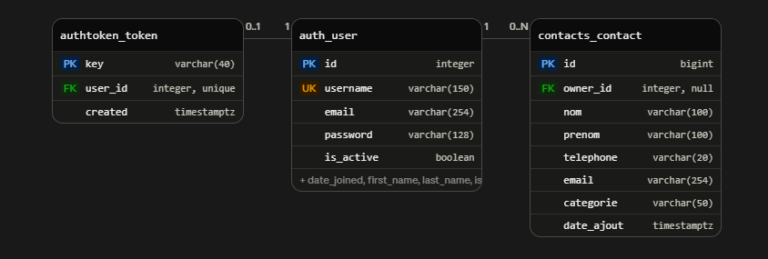

# 📒 Carnet de contacts

Application web full-stack pour gérer ses contacts personnels : chaque utilisateur crée un compte, puis ajoute, recherche, modifie et supprime **ses propres contacts**, classés par catégorie.

🔗 **Démo en ligne** : https://carnet-contacts-gm1c.onrender.com

> L'API est hébergée sur le plan gratuit de Render : après une période d'inactivité, la première requête peut prendre environ une minute, le temps que le serveur se réveille.


## 🎯 Objectif du projet

Premier projet full-stack : comprendre comment un front-end **React** communique avec une **API REST Django** adossée à une base **PostgreSQL**, de la conception jusqu'à la mise en ligne.

## ✨ Fonctionnalités

**Comptes utilisateurs**

- Inscription et connexion avec authentification par token
- Déconnexion (le token est supprimé côté serveur)
- Champ mot de passe avec bouton afficher/masquer
- Messages d'erreur clairs (nom d'utilisateur déjà pris, identifiants incorrects, etc.)

**Gestion des contacts**

- Ajout, modification et suppression d'un contact
- Fenêtre de confirmation avant toute suppression
- Recherche instantanée par nom ou prénom
- Pagination de la liste (5 contacts par page)
- Catégories avec badges de couleur, avatar avec initiales
- Seul le prénom et le téléphone sont obligatoires ; le nom et l'email sont facultatifs
- Validation du numéro de téléphone (chiffres, espaces et `+` initial ; 8 à 15 chiffres), côté formulaire **et** côté API

**Interface**

- Thème sombre, responsive : sur mobile, le tableau devient une liste de cartes
- Compteur de contacts et nom de l'utilisateur connecté dans l'en-tête

## 🛠️ Technologies

| Partie          | Technologies                                                                                                       |
| --------------- | ------------------------------------------------------------------------------------------------------------------ |
| Front-end       | React, Vite, Axios, CSS                                                                                            |
| Back-end        | Python, Django, Django REST Framework, django-cors-headers, python-decouple, dj-database-url, WhiteNoise, Gunicorn |
| Base de données | PostgreSQL                                                                                                         |
| Hébergement     | Render (Static Site, Web Service, PostgreSQL)                                                                      |
| Outils          | Git, GitHub, VS Code                                                                                               |

## 🏗️ Architecture

```
Navigateur (React, Vite)
        │   requêtes HTTP + en-tête  Authorization: Token ...
        ▼
API REST (Django REST Framework)
        │   requêtes SQL
        ▼
PostgreSQL
```

Le front-end et le back-end sont deux projets indépendants qui échangent uniquement du JSON. Le serveur ne garde aucun état entre deux requêtes : c'est le token, envoyé à chaque appel par un intercepteur Axios, qui identifie l'utilisateur.

## 📁 Structure du projet

```
carnet-contacts/
├── backend/
│   ├── carnet_api/        # configuration Django (settings, urls)
│   ├── accounts/          # inscription, connexion, déconnexion
│   ├── contacts/          # modèle, serializer, vues, routes des contacts
│   ├── build.sh           # script de construction pour Render
│   ├── manage.py
│   ├── requirements.txt
│   └── .env.example       # modèle de configuration (à copier en .env)
├── frontend/
│   ├── src/
│   │   ├── components/    # AuthForm, ContactForm, ContactList, ConfirmModal, PasswordInput, Logo
│   │   ├── api.js         # instance Axios (adresse de l'API + token)
│   │   ├── App.jsx
│   │   └── App.css
│   └── package.json
└── docs/                  # captures d'écran
```

## 🗄️ Base de données

Trois tables PostgreSQL :

| Table              | Rôle                              | Colonnes principales                                                                                     |
| ------------------ | --------------------------------- | -------------------------------------------------------------------------------------------------------- |
| `auth_user`        | Comptes (fournie par Django)      | `id`, `username` (unique), `email`, `password` (haché)                                                   |
| `authtoken_token`  | Un token par utilisateur connecté | `key` (PK), `user_id` (FK, unique)                                                                       |
| `contacts_contact` | Les contacts                      | `id`, `owner_id` (FK vers `auth_user`), `nom`, `prenom`, `telephone`, `email`, `categorie`, `date_ajout` |

Un utilisateur possède **0 à plusieurs contacts** ; chaque contact appartient à un seul utilisateur.



## 🔌 API

Base de l'API en production : `https://carnet-contacts-api.onrender.com`

**Authentification** (accessible sans token)

| Méthode | Endpoint              | Description                        |
| ------- | --------------------- | ---------------------------------- |
| POST    | `/api/auth/register/` | Crée un compte et renvoie un token |
| POST    | `/api/auth/login/`    | Renvoie le token de l'utilisateur  |
| POST    | `/api/auth/logout/`   | Supprime le token (token requis)   |

**Contacts** (token requis, chaque utilisateur ne voit que ses contacts)

| Méthode | Endpoint              | Description         |
| ------- | --------------------- | ------------------- |
| GET     | `/api/contacts/`      | Liste ses contacts  |
| POST    | `/api/contacts/`      | Crée un contact     |
| GET     | `/api/contacts/<id>/` | Détail d'un contact |
| PUT     | `/api/contacts/<id>/` | Modifie un contact  |
| DELETE  | `/api/contacts/<id>/` | Supprime un contact |

Le token s'envoie dans l'en-tête de chaque requête :

```
Authorization: Token <votre_token>
```

## 🔒 Sécurité

- Mots de passe hachés par Django, jamais stockés ni renvoyés en clair
- API protégée par token ; sans token, réponse `401`
- Isolation des données : chaque requête est filtrée sur l'utilisateur connecté, et le propriétaire d'un contact est défini par le serveur, jamais par le client
- Secrets (clé Django, accès base de données) dans des variables d'environnement, fichier `.env` exclu de Git
- Validation des données côté serveur (téléphone, email, mot de passe)
- Mode `DEBUG` désactivé et hôtes autorisés restreints en production

## 🚀 Installation en local

### Prérequis

- Python 3.12 ou plus récent
- Node.js 20 ou plus récent
- **PostgreSQL 15 ou plus récent** (les versions récentes de Django n'acceptent plus les versions antérieures)
- Git

### 1. Cloner le dépôt

```bash
git clone https://github.com/fabiano3319/carnet-contacts.git
cd carnet-contacts
```

### 2. Back-end

```bash
cd backend
python -m venv env

# Windows (Git Bash)
source env/Scripts/activate
# Linux / macOS
# source env/bin/activate

pip install -r requirements.txt
```

Crée la base dans PostgreSQL :

```sql
CREATE DATABASE carnet_contacts_db;
```

Copie le modèle de configuration et renseigne tes valeurs :

```bash
cp .env.example .env
```

```env
SECRET_KEY=une_longue_chaine_aleatoire
DEBUG=True
DB_NAME=carnet_contacts_db
DB_USER=ton_utilisateur
DB_PASSWORD=ton_mot_de_passe
DB_HOST=localhost
DB_PORT=5432
```

> ⚠️ Le fichier `.env` contient des informations sensibles : il est ignoré par Git et ne doit jamais être publié. Adapte `DB_PORT` si ton serveur PostgreSQL n'utilise pas le port par défaut.

Applique les migrations et lance le serveur :

```bash
python manage.py migrate
python manage.py runserver
```

L'API est disponible sur `http://localhost:8000/api/`.

### 3. Front-end

Dans un **second terminal** :

```bash
cd frontend
npm install
npm run dev
```

L'application est disponible sur `http://localhost:5173`. Par défaut, elle appelle l'API sur `http://localhost:8000` ; pour viser une autre adresse, crée `frontend/.env` avec `VITE_API_URL=<adresse>`.

> Les deux serveurs doivent tourner en même temps.

## ☁️ Déploiement

| Partie          | Hébergement           | Configuration                                                               |
| --------------- | --------------------- | --------------------------------------------------------------------------- |
| Front-end       | Render, _Static Site_ | Root `frontend`, build `npm install && npm run build`, publication `dist`   |
| API             | Render, _Web Service_ | Root `backend`, build `bash build.sh`, démarrage `gunicorn carnet_api.wsgi` |
| Base de données | Render, _PostgreSQL_  | Adresse fournie à l'API via `DATABASE_URL`                                  |

**Variables d'environnement de l'API** : `SECRET_KEY`, `DEBUG` (`False`), `ALLOWED_HOSTS`, `DATABASE_URL`, `CORS_ALLOWED_ORIGINS`.
**Variable du front-end** : `VITE_API_URL` (adresse de l'API, intégrée au code à la construction).

Le déploiement est automatique : chaque `git push` sur `main` met à jour le service concerné.

## 🧭 Déroulement de la réalisation

1. **Conception** : choix du thème (carnet de contacts), du stack et de la structure en deux dossiers (`backend/`, `frontend/`)
2. **Back-end** : projet Django, modèle `Contact`, serializer, `ModelViewSet` et routes (API REST complète)
3. **Front-end** : projet React avec Vite, composants `ContactList` et `ContactForm`, appels à l'API avec Axios
4. **CRUD complet** : ajout, modification (formulaire pré-rempli) et suppression, avec état partagé entre les composants
5. **Base de données** : passage de SQLite à PostgreSQL, configuration par variables d'environnement
6. **Interface** : maquette, thème sombre, tableau avec avatars et badges, recherche, pagination, version mobile
7. **Authentification** : comptes utilisateurs, token, contacts rattachés à leur propriétaire, pages de connexion et d'inscription
8. **Finitions** : validation du téléphone, fenêtre de confirmation, affichage/masquage du mot de passe
9. **Déploiement** sur Render et mise en place du déploiement automatique

## 👤 Auteur

**Fabiano**
GitHub : [@fabiano3319](https://github.com/fabiano3319)
