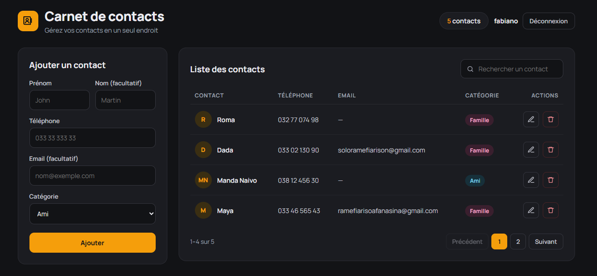

# 📒 Carnet de contacts

Application web full-stack pour gérer ses contacts : ajouter, consulter, rechercher, modifier et supprimer des contacts, classés par catégorie.

Projet réalisé pour apprendre la communication entre un front-end **React** et une API **Django REST Framework** adossée à une base **PostgreSQL**.



## ✨ Fonctionnalités

- Ajout d'un contact (prénom, nom, téléphone, email, catégorie)
- Liste des contacts sous forme de tableau avec avatar (initiales) et badge de catégorie
- Modification d'un contact (le formulaire se pré-remplit)
- Suppression avec confirmation
- Recherche instantanée par nom ou prénom
- Compteur de contacts dans l'en-tête
- Données persistantes dans PostgreSQL
- Interface responsive (le formulaire et la liste s'empilent sur petit écran)

## 🛠️ Technologies utilisées

| Partie | Technologies |
|---|---|
| Front-end | React, Vite, Axios, CSS |
| Back-end | Python, Django, Django REST Framework, django-cors-headers, python-decouple |
| Base de données | PostgreSQL |
| Outils | Git, GitHub, VS Code |

## 📁 Structure du projet

```
carnet-contacts/
├── backend/
│   ├── carnet_api/        # configuration du projet Django (settings, urls)
│   ├── contacts/          # app Django : modèle, serializer, vues, routes
│   ├── manage.py
│   ├── requirements.txt
│   └── .env.example       # modèle de configuration (à copier en .env)
└── frontend/
    ├── src/
    │   ├── components/    # ContactForm.jsx, ContactList.jsx
    │   ├── App.jsx
    │   └── App.css
    └── package.json
```

## 🚀 Installation

### Prérequis

- Python 3.10 ou plus récent
- Node.js 18 ou plus récent
- **PostgreSQL 15 ou plus récent** (les versions récentes de Django n'acceptent plus les versions antérieures)
- Git

### 1. Cloner le dépôt

```bash
git clone https://github.com/fabiano3319/carnet-contacts.git
cd carnet-contacts
```

### 2. Configurer le back-end

```bash
cd backend
python -m venv env

# Windows (Git Bash)
source env/Scripts/activate
# Linux / macOS
# source env/bin/activate

pip install -r requirements.txt
```

Crée la base de données dans PostgreSQL :

```sql
CREATE DATABASE carnet_contacts_db;
```

Copie le fichier d'exemple et renseigne tes propres valeurs :

```bash
cp .env.example .env
```

```env
DB_NAME=carnet_contacts_db
DB_USER=ton_utilisateur
DB_PASSWORD=ton_mot_de_passe
DB_HOST=localhost
DB_PORT=5432
```

> ⚠️ Le fichier `.env` contient des informations sensibles : il est ignoré par Git et ne doit jamais être publié.
> Adapte `DB_PORT` si ton serveur PostgreSQL n'utilise pas le port par défaut.

Applique les migrations et lance le serveur :

```bash
python manage.py migrate
python manage.py runserver
```

L'API est disponible sur `http://localhost:8000/api/contacts/`.

### 3. Configurer le front-end

Dans un **second terminal** :

```bash
cd frontend
npm install
npm run dev
```

L'application est disponible sur `http://localhost:5173`.

> Les deux serveurs (Django et Vite) doivent tourner en même temps : React récupère ses données en appelant l'API Django.

## 🔌 API

URL de base : `http://localhost:8000/api/`

| Méthode | Endpoint | Description |
|---|---|---|
| GET | `/contacts/` | Liste tous les contacts |
| POST | `/contacts/` | Crée un contact |
| GET | `/contacts/<id>/` | Détail d'un contact |
| PUT | `/contacts/<id>/` | Modifie un contact |
| DELETE | `/contacts/<id>/` | Supprime un contact |

Exemple de contact au format JSON :

```json
{
  "id": 1,
  "nom": "Mendrika",
  "prenom": "Marta",
  "telephone": "033 11 923 89",
  "email": "marta@example.com",
  "categorie": "Ami",
  "date_ajout": "2026-10-15T17:40:00Z"
}
```

## 🔮 Améliorations possibles

- Authentification (chaque utilisateur voit uniquement ses contacts)
- Pagination et tri des colonnes
- Filtre par catégorie
- Déploiement (Render / Railway pour l'API, Vercel / Netlify pour le front-end)

## 👤 Auteur

**Fabiano** — étudiant en L3 Informatique de gestion
GitHub : [@fabiano3319](https://github.com/fabiano3319)
